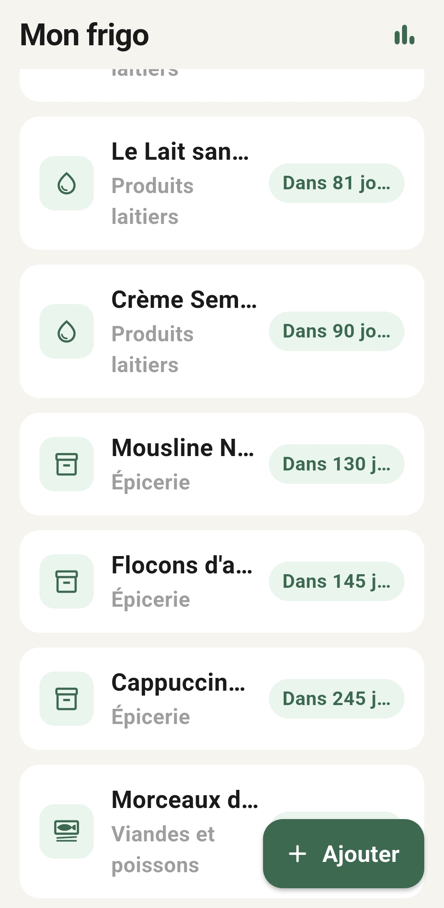
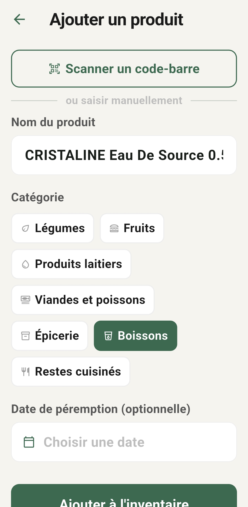
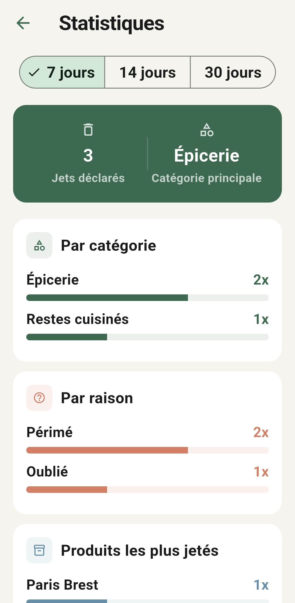
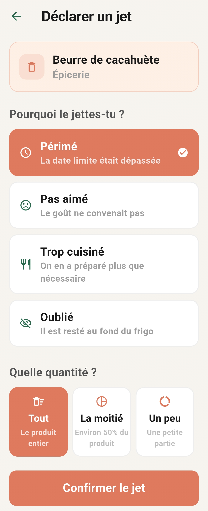

# FridgeFlow

Application mobile anti-gaspi alimentaire développée avec Flutter.  
Objectif : réduire les pertes alimentaires en suivant les produits du frigo et en anticipant les dates de péremption.

---

## Contexte

Projet personnel lancé pour apprendre Flutter de A à Z, en partant d'un problème concret du quotidien.  
L'application est en phase de test réel (usage quotidien) depuis début 2025.

---

## Fonctionnalités

- **Scan de codes-barres** — récupération automatique des informations produit via l'API Open Food Facts
- **Gestion du frigo** — ajout, suppression, swipe pour marquer un produit comme consommé ou gaspillé
- **Dates de péremption** — suivi visuel avec alertes de proximité
- **Statistiques** — taux de gaspillage sur plusieurs périodes (semaine, mois, total)
- **Notifications quotidiennes** — rappels locaux pour les produits proches de leur expiration
- **Interface redesignée** — palette vert profond / crème / terracotta

---

## Stack technique

| Couche | Technologie |
|---|---|
| Framework | Flutter / Dart |
| Base de données locale | SQLite via Drift |
| State management | Provider |
| Scan | flutter_barcode_scanner |
| Données produits | Open Food Facts API |
| Notifications | flutter_local_notifications |
| Versioning | Git / GitHub via VSCode |

---

## Illustrations

### Écran principal — liste du frigo

### Scan d'un produit

### Statistiques

### Déclarer un jet

<!-- ### Notifications
 -->

---

## Roadmap

- [x] MVP — ajout, suppression, swipe, notifications
- [x] Statistiques multi-périodes
- [x] Refonte UI
- [ ] Phase 3 — Suggestions de recettes + alertes personnalisées
- [ ] Phase 4 — Multi-utilisateurs liés à un foyer (Supabase)
